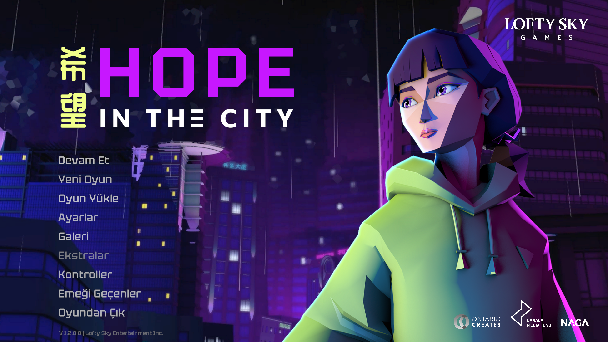
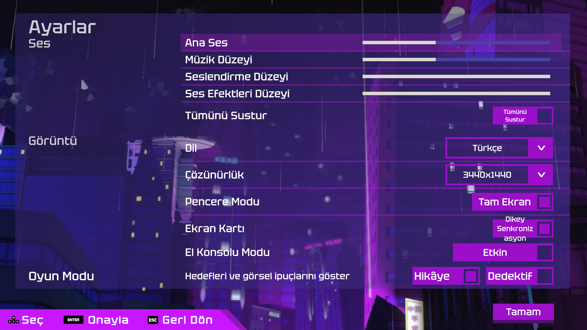
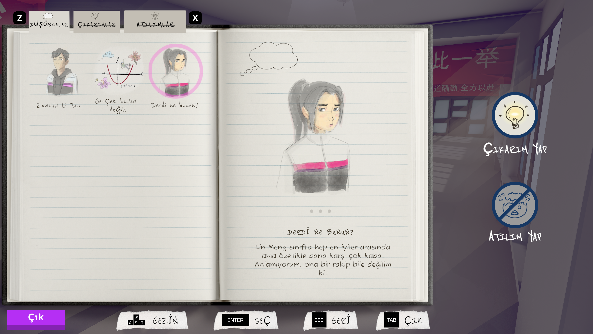
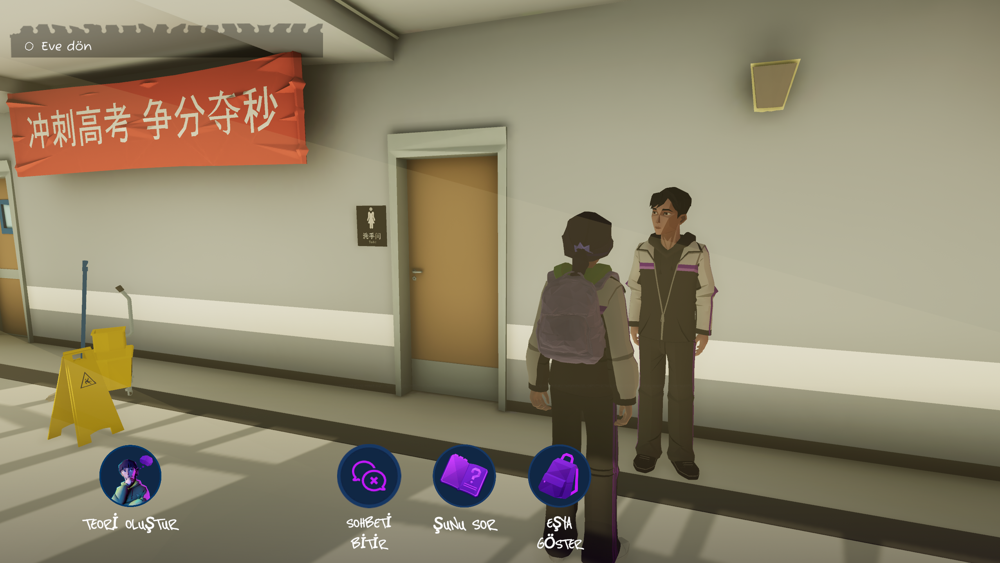
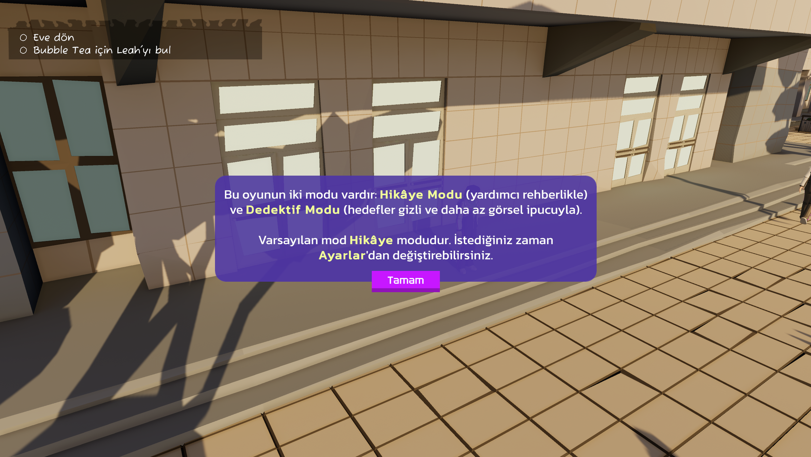
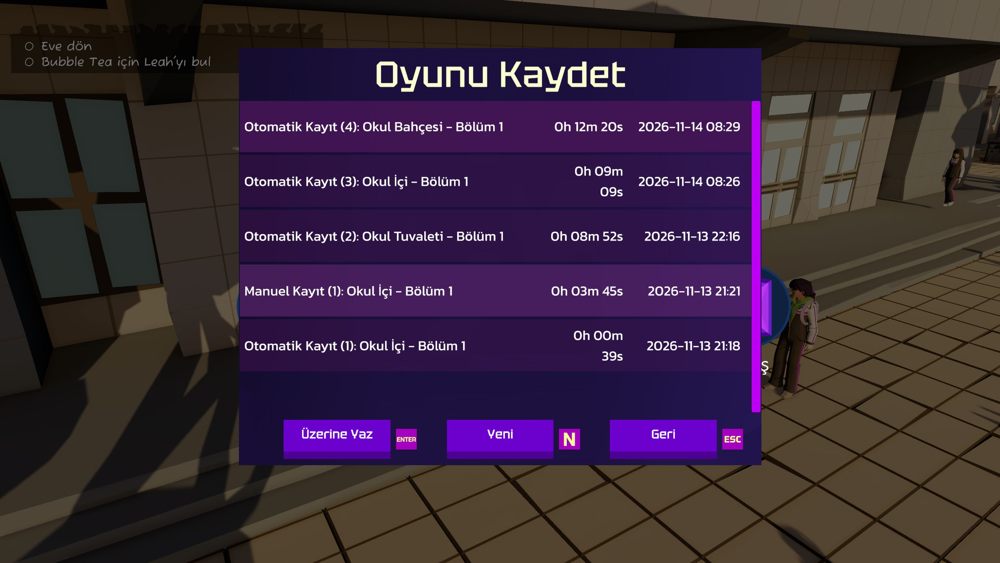
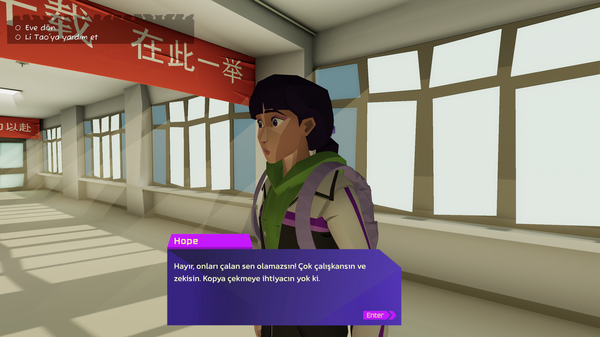
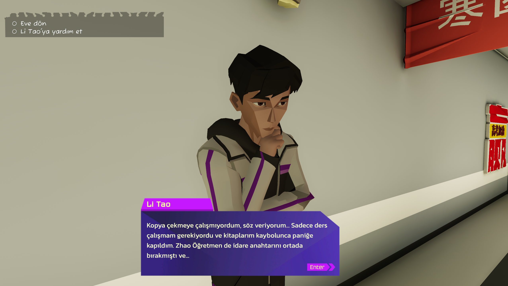
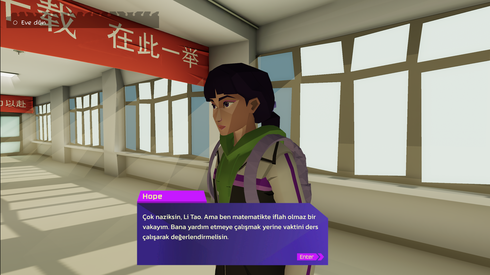

# Hope in the City — Türkçe Yama 🇹🇷

**Orijinal font dokusunu bozmadan hazırlanmış, minimal ve tam kapsamlı Türkçe yerelleştirme yaması.**

 

&nbsp;&nbsp;&nbsp;&nbsp;

---

## Hakkında

**[Hope in the City](https://store.steampowered.com/app/3610790/Hope_in_the_City/)** oyunu için hazırlanan bu yama, oyunun kendi görsel kimliğini ve el yazısı fontlarını koruyarak oyunu baştan sona Türkçeye çevirir.

> [!NOTE]
> Bu projenin Türkçe çevirisi ve çalışma zamanı patcher modu **Gemini 4 Hydrogen Extra** ile yapılmıştır.

> [!IMPORTANT]
> **Uyumlu Sürüm:** Mevcut Steam sürümü olan **V 1.2.0.0** üzerinde sorunsuz çalışır.

> [!WARNING]
> **Güncelleme Uyarısı:** Oyuna ileride gelebilecek Steam güncellemeleri `Assembly-CSharp.dll` ve dil dosyalarının üzerine yazabileceği için yamayı **bozabilir veya devre dışı bırakabilir**. Böyle bir durumda yama klasöründeki **`Yama_Kaldir.bat`** dosyasını çalıştırarak orijinal dosyalara dönebilir veya yamanın güncel sürümünü bekleyebilirsiniz.

---

## Mod ve Çeviri Özellikleri

| Özellik | Açıklama |
| :--- | :--- |
| **Tam Kapsamlı Çeviri** | `3.065` oyun içi metin satırı (diyaloglar, not defteri, düşünceler, çıkarımlar, atılımlar, görevler, arayüz, harita ve kayıt etiketleri) eksiksiz Türkçedir. |
| **Belgesel Altyazıları** | *Ekstralar* bölümündeki **6 videonun** tamamı (`.srt`) V 1.2.0.0 zamanlamalarıyla senkronize şekilde Türkçeye çevrilmiştir. |
| **Orijinal Font Koruması** | Stilize el yazısı ve arayüz fontları (`Kanit`, `Tektur`, `FuzzyBubbles`, el yazısı notlar) değiştirilmez; eksik Türkçe karakterler (`Ç, Ğ, İ, Ö, Ş, Ü, ç, ğ, ı, ö, ş, ü`) için çalışma zamanında dinamik glif tablosu ve `GoogleSans` yedeği üretilir. |
| **El Konsolu Modu Desteği** | V 1.2.0.0 güncellemesiyle eklenen *El Konsolu Modu (Handheld Mode)* açılıp kapatıldığında Türkçe karakter desteği sorunsuz devam eder. |
| **Minimal ve Temiz Yapı** | Unity `.assets` dosyalarına dokunulmaz; BepInEx gibi ek mod yükleyici gerekmez. İngilizce (`en-US`) yuvası üzerinden çalışır ve oyun ilk açılışta doğrudan **Türkçe** başlar. |
| **Hazır Yedek & Kolay Kaldırma** | Arşiv içinde orijinal V 1.2.0.0 `.bak` dosyaları hazır olarak gelir; tek tıkla **`Yama_Kaldir.bat`** çalıştırılarak oyun anında orijinal hâline döndürülür. |

---

## Kurulum ve Kaldırma

### Kurulum
1. Yukarıdaki **[İndir](https://github.com/kircastudios/Hope_in_the_City_TURKISH/releases/latest/download/Hope_in_the_City_Turkce_Yama_v1.2.0.0.zip)** butonuna tıklayarak `Hope_in_the_City_Turkce_Yama_v1.2.0.0.zip` arşivini indirin.
2. Arşivdeki **`HITC_Data`** klasörünü ve **`Yama_Kaldir.bat`** dosyasını oyunun kurulu olduğu ana klasöre (`HITC.exe` dosyasının yanına) atın ve **hedef dosyaları değiştirin**.
   > Varsayılan Steam yolu: `C:\Program Files (x86)\Steam\steamapps\common\Hope in the City`
3. Oyunu Steam'den başlatın — doğrudan **Türkçe** açılacaktır.

### Kaldırma (Orijinale Dönüş)
- Oyun klasörüne attığınız **`Yama_Kaldir.bat`** dosyasını çalıştırın (gerekirse sağ tıklayıp **Yönetici olarak çalıştır** seçin).
- Arşivle birlikte gelen orijinal **`Assembly-CSharp.dll.bak`** ve **`en-US.csv.bak`** yedekleri otomatik olarak geri yüklenir ve eklenen `.srt` altyazıları temizlenir.

---

## Oyun İçi Ekran Görüntüleri

| Ana Menü (`Main_Menu.png`) | Ayarlar (`Settings.png`) |
| :---: | :---: |
|  |  |

| Not Defteri (`Journal.png`) | Etkileşim Seçenekleri (`InGame_3.png`) |
| :---: | :---: |
|  |  |

| Arayüz — Mod Bilgilendirme (`UI_1.png`) | Arayüz — Kayıt Ekranı (`UI_2.png`) |
| :---: | :---: |
|  |  |

| Oyun İçi Diyalog 1 (`InGame_1.png`) | Oyun İçi Diyalog 2 (`InGame_2.png`) |
| :---: | :---: |
|  |  |

**Oyun İçi Diyalog 3 (`InGame_4.png`)**

---

## Geliştiriciler İçin Depo Yapısı

- `src/RuntimeLib/` — Çalışma zamanı font fallback ve harici metin/SRT yükleyici C# kodu (`TurkishPatchRuntime.cs`).
- `src/Patcher/` — `Mono.Cecil` tabanlı IL yama aracı (`Program.cs`).
- `screenshots/` — V 1.2.0.0 sürümünden alınan oyun içi ekran görüntüleri.
